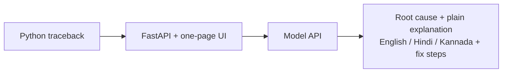

# 🐛 DebugDost

Paste a Python traceback. Get the root cause, a plain-language explanation, and concrete fix steps — in English, Hindi, or Kannada.

Built for the **BharatCode Build League** on BharatCode's model API (Qwen).

## Live demo

https://huggingface.co/spaces/shashankvkaramudi/debugdost

## How it works

- FastAPI backend (`app.py`) + one-page HTML UI (`static/index.html`).
- `POST /api/explain` `{"traceback": str, "language": "en"|"hi"|"kn"}` → `{"root_cause": str, "explanation": str, "fix_steps": [str]}`.
- The model is called through BharatCode's OpenAI-compatible API (`https://bharatcode.ai/api/model/v1`, model `qwen-3.8-27b`) with the OpenAI Python SDK.
- The API key comes from the `BHARATCODE_API_KEY` environment variable. It is never committed to this repo. Without a key the API answers 503 with a clear message.

## Run locally

```bash
pip install -r requirements.txt
BHARATCODE_API_KEY=your_key_here uvicorn app:app --port 8000
```

Then open http://localhost:8000.

## Tests

```bash
python -m pytest tests/ -q
```

5 tests, mocked model client — no API key needed.

## What it deliberately does not do

- No generic code generation: it explains only the pasted error.
- When the traceback is not enough to tell, it says so instead of guessing.
- No diagnosis beyond the pasted error, no invented library behaviour.

## Architecture



